# rpl.ai

**The HP 48/49/50 RPL calculator, rebuilt for the screen in front of you.**

rpl.ai is a programmable RPL calculator that runs in any modern browser and
keeps working offline. It implements the HP 50g's User-RPL language and most
of its command set: 636 commands, exact big-integer and rational arithmetic,
units, lists, matrices, programs and directories. It swaps the 131×80 LCD
for a high-resolution stack, a real keyboard, mouse or touch screen, and the
[Giac](https://www-fourier.univ-grenoble-alpes.fr/~parisse/giac.html)
computer algebra system. Giac is the work of Bernard Parisse, who also wrote
the CAS inside the HP 49 and 50g.

**[Open rpl.ai](https://praevitium.github.io/rpl.ai/)**. There is nothing to
download, no account and no sign-up.

> [!TIP]
> **Install it as an app.** Open rpl.ai and press the green **Install**
> button in its top bar. It then opens from your home screen, dock or Start
> menu in its own window, like any other app, and works with no network.
> [How to install, browser by browser](#install-it-as-an-app).

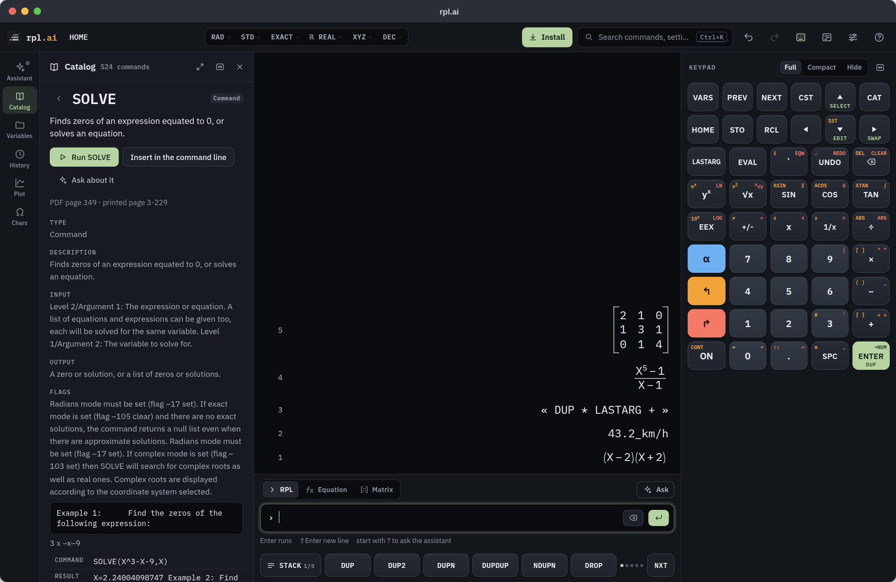

- **The HP 50g you know, where you can see it.** Stack, soft menus, shifted
  keys, VARS, CST, MODES, directories and `HALT`/`CONT` debugging, each
  reachable from a labelled control.
- **Keyboard first, mouse and touch friendly.** Type anywhere to enter.
  `⌘K` (Ctrl+K) searches everything, and every soft key, level and menu
  works with a click or a tap. Swipe a level sideways to drop it.
- **An equation writer that thinks with you.** Type `(x^5-1)/(x-1)` and it
  typesets as you go. Underneath, it shows the value, a plot, the
  simplification, the factorisation, the derivative, the zeros and even
  removable singularities.
- **Previews before you commit.** Hover a soft key, or hold one on a phone,
  to see what it will do to your stack, and why it would fail if it can't run.
- **Errors that explain themselves.** "SIN can't use a string." The
  offending level is outlined, one-click fixes are offered, and nothing is
  lost.
- **A tutor, not just an answer engine.** The optional assistant turns a
  physics or maths problem into steps you work through on your own stack.
  It checks each step and gives hints before it gives answers. It runs on a
  model you choose, on your own computer or through Ollama's cloud.
- **At home on a phone.** The HP keypad, or a Minimal view with just the
  stack, ⌫ and Enter; a strip of RPL keys above the phone's keyboard;
  finger-sized controls; and a back button that closes what's open first.
- **Installable and offline.** Plain static files with no server behind
  them. Once loaded, it runs without a network.

## At a glance

| Area | What you get |
|---|---|
| **Numbers** | Exact big integers and fractions (`100 FACT` gives all 158 digits, `1/3 2/5 +` gives `11/15`), 12-digit reals, complex numbers, and binary integers in any base |
| **Algebra and calculus** | The Giac CAS behind SOLVE, FACTOR, EXPAND, PARTFRAC, DERIV, INTEG, TAYLR, SERIES, LAPLACE and ILAP, with `∫` and `∂` written inside algebraics |
| **Units** | The HP 50g's whole unit catalog with SI prefixes, CONVERT and UBASE, and units inside algebraics |
| **Linear algebra** | Vectors and matrices with DET, INV, RANK, LU, QR, SCHUR, CHOLESKY, EGV and LINSOLVE, and a matrix writer that pastes from spreadsheets |
| **Statistics** | ΣDAT and Σ+, MEAN, SDEV, LINFIT, BESTFIT and BINS, and distributions such as NDIST and UTPN |
| **Programming** | User RPL with `« »`, IF, CASE, FOR, WHILE and IFERR (typed from the HP's BRCH menu), local variables, recursion, DEFINE, directories, and HALT, SST, SST↓ and DBUG for debugging |
| **Plots** | FUNCTION, POLAR, PARAMETRIC, DIFFEQ, scatter, bar and histogram plots, with trace, zoom and PNG export |
| **Data in and out** | Copy and paste with Excel, Google Sheets and Numbers; CSV, TSV, `.xlsx`, JSON and HP `.rpl` files; LaTeX copied out and pasted in |
| **Input** | Keyboard first with `⌘K` search, the HP 50g keypad on screen, and a phone layout with its own key strip |
| **Assistant** | Optional. A model you run with Ollama explains, solves, writes programs and tutors, acting on your stack with one-click undo |
| **Where it runs** | Any modern browser, installable as an app, offline after the first visit, with no account; your data stays in the browser |

**Contents:** [Get started](#get-started) ·
[Five minutes with RPL](#five-minutes-with-rpl) · [Keyboard](#keyboard) ·
[On a phone](#on-a-phone) · [Tour](#tour) ·
[Set up the assistant](#set-up-the-assistant) ·
[Limitations](#limitations) · [For developers](#for-developers) ·
[Why this exists](#why-this-exists)

---

## Get started

1. **Open [praevitium.github.io/rpl.ai](https://praevitium.github.io/rpl.ai/)**
   in Chrome, Edge, Firefox or Safari, on a computer, tablet or phone.
2. **Install it (optional).** Press **Install** in the top bar, as below.
3. **Take the tour.** A short tour runs the first time and points at the
   controls your screen shows, on a phone and in Minimal view too. Replay it
   from Help › Take the tour, or from the ⋯ menu on a phone.

### Install it as an app

Press the green **Install** button at the top of rpl.ai (a download arrow on
a phone; on the smallest phones, ⋯ › Install as an app). The browser asks
you to confirm, or rpl.ai tells you where it keeps its install command:

| Browser | How to install |
|---|---|
| Chrome or Edge, on a computer or Android | Press Install and confirm, or use the install icon at the right of the address bar |
| Safari on a Mac | File › Add to Dock |
| iPhone and iPad, in any browser | Share › Add to Home Screen |
| Other Android browsers | The browser menu's Install app or Add to Home screen |
| Firefox on a computer | Firefox can't install web apps; rpl.ai works in a Firefox tab, offline included |

The installed app has no Install button, and in Chrome neither does a
browser tab once the app is installed.

After the first visit, rpl.ai runs offline. When you are online it checks
for a new version, and an installed copy offers to reload when one is
ready.

Your stack, variables and settings stay in this browser on this device.
Nothing is uploaded. Two windows of the same browser share them and stay in
step. To move them to another browser or keep a copy, use Back up everything
in the Variables drawer, and Restore from file on the other side.

### Five minutes with RPL

RPL puts the numbers first and the operation last. Each value goes on the
**stack**, and a command takes its arguments from the bottom of it.

- **Arithmetic.** Type `24` Enter `15`, then press × on the keypad for
  `360`: as on the HP, the key enters 15 and multiplies at once. Typed on a
  keyboard, `*` is just text, so a whole line works too: `2 3 + 4 *` Enter
  gives `20`. Fractions stay exact: `1/3 2/5 +` gives `11/15`. So do roots,
  as in the HP's exact mode: `8 √` gives `2√2`, and `27 2/3 ^` gives `9`.
- **Algebra.** Push `` `X^2-4` `` and run `FACTOR` for `(X−2)(X+2)`, or
  `` `X^2-5*X+6=0` `X` SOLVE `` for `{ X=2 X=3 }`. The ` key stands in for
  the HP's ' key, and the command line reads apostrophes too: `'X^2-4'`
  is the same object. Or press `⌘E`, type `x^2-5x+6=0`, and click the Solve
  card. `` `EXP(X)` `X` 3 TAYLR `` gives the Taylor polynomial
  `1+X+1/2*X^2+1/6*X^3`, SERIES expands around any point with the limit and
  remainder, and ZEROS lists the roots on their own. SOLVEVX solves for the
  current variable, or the only one there is: `` `T^2=9` SOLVEVX `` gives
  `{ T=-3 T=3 }`. Both solvers take a list of equations too and solve each
  one. `ROOT` finds a root numerically from a guess:
  `` `COS(X)=X` `X` 1 ROOT `` gives 0.739085133215 and stores it in X, and a
  program can stand in for the expression. `COLLECT` factors over the
  integers only, so `` `X^2-2` `` stays whole where FACTOR splits it with
  √2. The where operator `|` (↱9) puts values in without the CAS and
  simplifies nothing: `` `X^2+Y` { X 2 Y 3 } | `` gives `2^2+3`, which
  EVAL makes 7. The CAS menu opens on folders after the HP's CAS menus:
  ALG (COLLECT, EXPAND, FACTOR, LNCOLLECT, LIN, PARTFRAC, SOLVE, SUBST,
  TEXPAND), CALC, S.SLV, TRIG and EXP&LN. TRIGCOS, TRIGSIN and TRIGTAN
  rewrite with SIN²+COS²=1: `` `SIN(X)^2` TRIGTAN `` gives
  `TAN(X)^2/(TAN(X)^2+1)`.
- **Money.** `TVMROOT` solves the HP's time-value-of-money variables N,
  I%YR, PV, PMT and FV for the one named. With 360 in `N`, 6.5 in `I%YR`,
  200000 in `PV`, 0 in `FV` and 12 in `PYR`, `` `PMT` TVMROOT `` gives
  -1264.13604699, the monthly payment, and stores it in PMT. `TVMBEG` and
  `TVMEND` put the payments at each period's start or end (flag -14), and
  `12 AMORT` splits the first twelve payments into principal and interest
  and gives the balance left. The TVM menu holds all four, and a key for
  each variable stores level 1 in it; ⇦ solves for it and ⇨ recalls it.
- **Statistics.** `[ 1 2.1 ] Σ+` adds a point to ΣDAT, and `STOΣ` stores a
  whole matrix there. As on the HP, the statistics commands read only ΣDAT,
  never an array on level 1. After the points
  (1, 2.1), (2, 3.9), (3, 6.2) and (4, 7.8), `LR` gives the intercept 0.15
  and slope 1.94, and `5 PREDY` gives 9.85. `SCATRPLOT` plots the points,
  the XCOL column against the YCOL column, and `BARPLOT` and `HISTPLOT` the
  XCOL column. The STAT menu opens on the HP's folders: DATA (Σ+, Σ-, CLΣ),
  ΣPAR, 1VAR, PLOT, FIT and SUMS.
  Once ΣDAT exists, `3 1 7 Σ+` adds a point from separate numbers, the
  quickest way on a phone. The Σ+, Σ-, CLΣ and STOΣ keys say how many points
  ΣDAT holds, and a statistics command run with an array on the stack but no
  ΣDAT offers to store it there. The PROB menu has the HP's keys in its
  order, `COMB` `PERM` `!` `RAND` `RDZ`, then the upper-tail distributions
  `UTPC` `UTPF` `UTPN` `UTPT` and `NDIST`, to 12 digits:
  `0 1 1.96 UTPN` gives 2.49978951482E-2.
- **Integers and polynomials.** Integers are exact at any size, so
  `2 64 ^ NEXTPRIME` gives 18446744073709551629. The INTGR menu opens on the
  HP's ARITH folders, INTEG and MODUL, then DIVIS, FACTORS and PROPFRAC;
  opening MODUL says the modulus its commands use (13 until `MODSTO` sets
  another), and its MODSTO key says the new one.
  `PROOT`, `PCOEF` and `PEVAL` take the HP's arrays:
  `[ 2 -3 4 -5 ] PCOEF` gives `[ 1 2 -25 -26 120 ]`. `DIV2`, `EGCD` and
  `ABCUV` are IDIV2, IEGCD and IABCUV for polynomials:
  `` `X^2+1` `X-1` EGCD `` gives 2, 1 and `-X-1`.
- **Bases.** `#FFh` is a binary integer; `HEX`, `DEC`, `OCT` and `BIN` show
  them in another base, and `8 STWS` sets the word size, so `#81h RL` gives
  `#3h`. The BASE menu holds them as the HP's does, with folders for
  LOGIC (AND, OR, XOR, NOT), BIT (RL, SL, ASR, SR, RR) and BYTE (RLB, SLB,
  SRB, RRB). A mode key there or in any menu (HEX, DEG, RECT, CMPLX) shows a mark
  while its mode is on, and on a phone the modes summary names the base,
  polar coordinates and complex mode whenever they aren't the defaults.
- **Complex numbers.** `(3,4)` is 3+4i and `(2,∠1.5)` is typed in polar
  form; `CYLIN` shows them that way. The CMPLX menu leads with the HP's
  RE IM C→R R→C ABS ARG, then SIGN NEG CONJ, then the coordinate modes, and
  an integer power is exact, so `(1,1) 2 ^` gives `(0, 2)`. LN and LOG of a
  negative real give its principal complex value with CMPLX on or off, as on
  the HP: `-1. LN` gives `(0, 3.14159265359)`. The TRIG menu opens on the
  HP's HYP folder: SINH ASINH COSH ACOSH TANH ATANH, then EXPM and LNP1.
- **Matrices.** `[[ 2 1 ][ 1 3 ]] DET` gives 5, `INV`, `EGV` and `LU` work
  on it, and `→NUM` gives every entry its number. The MATRIX menu opens as
  the HP's MTH MATR does, on MAKE, NORM, FACTR, COL and ROW folders and
  then LSQ. A matrix level's ⋯ menu has Inverse and Determinant when it is
  square, and Transpose. In CYLIN and SPHERE modes `→V2`, `→V3` and `V→`
  take and give a vector's polar parts, as on the HP: `2 90 →V2` in DEG is
  `[ 2 ∠90 ]`. The VECTOR menu holds the HP's MTH VECTR keys, `ABS`, `DOT`,
  `CROSS`, `V→`, `→V2` and `→V3`, then the RECT, CYLIN and SPHERE modes.
- **Lists and strings.** `{ 10 20 30 } 2 GET` gives 20,
  `{ 1 2 3 } « SQ » MAP` gives `{ 1 4 9 }`, and `"HELLO" 2 3 SUB` gives
  `"EL"`. The LIST menu opens on the HP's folders: ELEM and PROC from its
  PRG LIST menu and CHARS, its string commands, then OBJ→, →LIST, SUB and
  REPL. `→STR` writes a number in the display format, as on the HP, so
  `2 FIX "Total: " 12.3456 →STR +` gives `"Total: 12.35"`, and a string
  at level 1 shows whole, line breaks included.
- **Programs.** `` « DUP * » `SQUARE` STO `` stores a program; `5 SQUARE`
  then gives `25`, and SQUARE appears on the VARS menu. A stored program
  runs by name like a built-in. Built-in names such as `SQ` are reserved.
- **Local variables.** `« 2 3 → a b « a b + a b * » » EVAL` leaves `5` and
  `6`.
- **Errors in programs.** `« IFERR 1 0 / THEN ERRN END » EVAL` traps the
  error and gives `#773d`, the HP's `#305h` for Infinite result, as the
  common errors all carry the HP's numbers; `"Disk full" DOERR` raises a
  program's own, shown as its banner's title. The LOGIC menu follows the HP's PRG TEST pages:
  `== ≠ < > ≤ ≥`, then AND OR XOR NOT SAME TYPE, then the flag tests.
- **User functions.** `'F(X)=X^2+1' DEFINE` stores `« → X 'X^2+1' »` in F, as
  on the HP 50g. Then `'F(3)' EVAL` gives `10`, `'F(A+1)' EVAL` gives
  `(A+1)^2+1`, and `'F(X)'` plots. Any stored program can be called this way
  inside an algebraic. IFTE picks a branch inside an algebraic too, so a
  function can call itself: `'R(N)=IFTE(N<=1,1,N*R(N-1))' DEFINE` then
  `'R(10)' EVAL` gives `3628800`. Tests combine with AND, OR, XOR and NOT:
  `'X>1 AND X<5'` is an algebraic, and `'X^2>4' 'X' SOLVE` gives
  `{ X<-2 X>2 }`. A definite integral is written as on the HP,
  `'∫(0,1,X^2,X)'`, and a derivative as `'∂X(X^2)'`; EVAL asks the CAS for
  them and →NUM works the integral out numerically. A sum is too,
  `'Σ(k=1,10,k^2)'`, or Σ builds it from the index, its limits and the
  summand: `'k' 1 10 'k^2' Σ` gives `385`, and `'N' 1 5 'A^N' Σ` the sum in
  closed form.
- **Units.** `100_km 2_h /` gives `50._km/h`; then `1_m/s CONVERT` gives
  `13.8888888889_m/s`. SI prefixes work on SI units (`5_kJ`, `1_MHz`,
  `3_uA`), and a bare `°C` or `°F` converts as a thermometer reading:
  `100_°C 1_°F CONVERT` gives `212._°F`. Units keep the order they were
  written in, as on the HP: `5_N 2_m *` gives `10._N*m`, and
  `3_ft*lbf 1_N*m CONVERT` gives `4.06745384499_N*m`. The UNITS menu
  groups the units as on the HP 50g (LENG, AREA, VOL, TIME, SPEED, MASS,
  FORCE, ENRG, POWR, PRESS, TEMP, ELEC, ANGL, LIGHT, RAD, VISC), with a key
  for each. A unit key multiplies level 1 by the unit, ↰ converts level 1
  to it and ↱ divides by it, so `5` ft then ↰ m gives `1.524_m`; a finger
  held on the key offers both. SIN, COS and TAN take an angle unit, which
  overrides the angle mode: `30_° SIN` gives `0.5` whatever DEG, RAD or GRD
  says. CONST knows the 39 constants of the HP's Constants Library by name,
  in their units and with CODATA 2018 values: `'c' CONST` gives
  `299792458._m/s`, and with flag -61 set it gives the number alone. CONLIB
  (a key in the UNITS menu) lists them all with what each is and its value,
  and a tap puts one on the stack, as the HP's library does. MOLWT gives a
  formula's molar mass: `"Ca(OH)2" MOLWT` gives `74.09268_g/mol`, from
  standard atomic weights (the HP writes the unit g/gmol). Units
  work inside algebraics too, with a compound unit in
  parentheses: store `2_s` in `T` and `'9.81_(m/s^2)*T^2/2' EVAL` gives
  `19.62_m`. In the equation writer, `_` after a number starts its unit, and
  the UNITS menu keys type their unit after the number too: pick a menu from
  the menu bar while a writer is open and it takes the writer's place until
  you pick EQW or MTRW again.
- **The stack.** Click a level to select it; its actions appear on the row
  and in the menu bar. Double-click edits it in the right writer. Drag rows
  to reorder them. A program opens for editing laid out over lines, each
  structure (IF, CASE, FOR, WHILE and the rest) starting a line and nested
  programs indented, with room for it to show.

### Keyboard

On Windows and Linux, ⌘ is Ctrl and ⌥ is Alt.

| Keys | Does |
|---|---|
| `⌘K` | Search commands, settings, variables and help |
| `⌘E` · `⇧⌘M` | Equation writer · Matrix writer (press again to carry it to the command line) |
| `⌘I` | Ask the assistant (or start a line with `?`) |
| `F1`–`F6` · PgUp/PgDn | Soft keys · menu pages |
| `↑` · `↓` on an empty line | Select level 1 · edit level 1 |
| Enter · `→` on an empty line | DUP · SWAP |
| With a level selected | `↑` `↓` move the selection · `⌘↑` `⌘↓` move the level · Enter edits · ⌫ drops · `⌘C` copies · `⌘D` picks |
| `⌘Z` · `⇧⌘Z` | Undo · redo (text when the line has text, otherwise the stack) |
| `⌘\` · `⌘;` · `⇧⌘F` | Tools drawer · keypad · Minimal view |
| `⌘,` · `⌘/` | Settings · every shortcut, grouped by where it applies |
| Tab | Complete a command or variable name; next box or next cell in the writers |
| Enter in the matrix writer | Stores the cell and moves on, as the HP's ENTER; on a cell you haven't typed in it pushes the matrix, so `1` Enter `2` Enter Enter enters `[[ 1 2 ]]` · ⇧Enter next row |
| Esc | Close, deselect, dismiss, or cancel with Undo |

Hold ⌥ (Alt) to see each keypad key's keyboard shortcut.

### On a phone

| HP keypad | Minimal view |
|:---:|:---:|
| 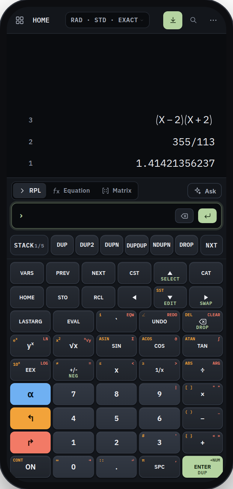 | 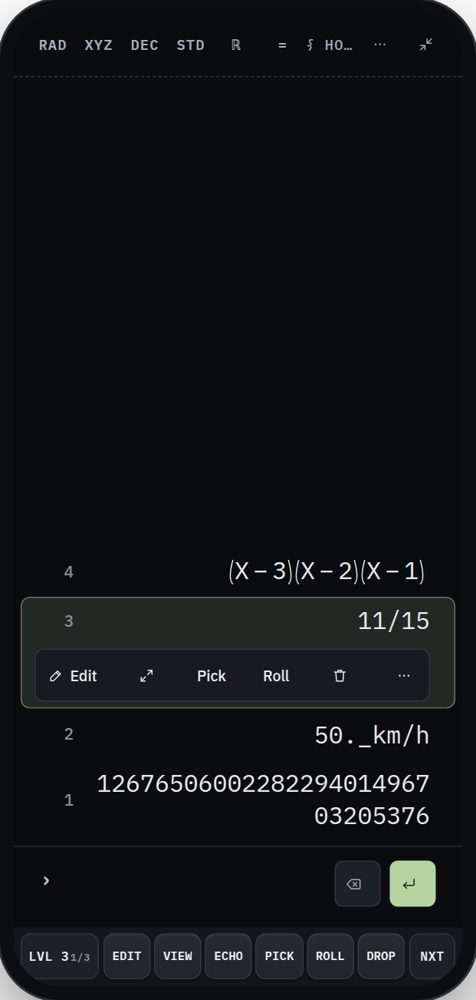 |

- The on-screen keypad has the HP 50g's layout, shift keys included, and
  its keys work like the HP's: with `4` on the command line, + or SIN enters
  it and runs at once. Inside a quote, string, program, list or unit they
  type. While the keypad shows, it does the typing and the phone's
  keyboard stays down; hide the keypad to type with the phone's keyboard.
  For more of the stack, choose Compact keypad from the ⋯ menu (or Keypad
  in Settings): five rows of the keys an RPN session reaches for most,
  with SWAP, DROP and UNDO beside the digits, SIN, COS and TAN on the
  shifted 7, 8 and 9, and under α the whole pad running a to z. Its keys
  name their shifts in landscape too. A window too short for the full
  keypad to leave two stack levels (under about 576 px tall, as in split
  screen) uses the compact keypad on its own, and the full one comes back
  when it grows; the setting stays Full.
  The command menus' soft keys do the same; the catalog types. A
  variable's key types its name inside a program, list or quote, and in a
  program ⇦ and ⇨ type a STO or RCL of it, as on the HP; a finger held on
  the key offers both, on a bare line too (store level 1 in it, or recall
  it without running). So does a CST
  key, whose command (such as SIN) runs on a bare line, and in a program
  the UNITS keys type `1_m *`, `1_m CONVERT` (⇦) or `1_m /` (⇨), or attach
  the unit to the number you are typing; with no shift key to hand, hold a
  finger on a unit key for its ⇦ and ⇨ forms. The MODES keys type their command
  there too (`DEG`, `FIX`, `HEX`) rather than changing the mode. A program
  can put up its own keys, as on the HP: `{ SIN COS } MENU` stores the list
  in CST and shows it, `TMENU` shows one without storing it, and `0 MENU`
  brings back the menu before (the HP's other menu numbers are not taken).
  An item can be `{ "label" object }` or `{ "label" { object ⇦object
  ⇨object } }`, as on the HP; a finger held on the key offers the shifted
  objects.
- Tap a stack level for its actions, on a line under it so they never cover
  the value: Edit, View, Pick (DUP on level 1), Roll above level 1 (SWAP on level 2), Conv for
  a value with units (from 360 px wide), Drop, and ⋯
  (or hold a finger on the level) for EVAL, →NUM, copy, share, store and the rest (and, for a program, Debug; for a value
  with units, Convert to…, which lists the value in every unit of the UNITS
  menu with the same dimensions, `254._cm`, `100._in`, `2.54_m`…, and runs
  CONVERT on the one you tap; the level's soft keys have it as CONV). View is the HP
  interactive stack's VIEW, which shows the level full size (a long number
  in full, a long list wrapped to the screen, a formula or matrix that scrolls both ways; pinch or double-tap to zoom) with Edit, Copy and
  Share under it; on a screen under 320 px wide (360 for a formula, which
  adds Plot) it waits in ⋯; at any width it is on the first page of the level's soft keys, beside EDIT. ⋯ also has →LIST, DUPN, DRPN
  and KEEP for levels 1 to the one you tapped (DUPN and DRPN above level 1), and LEVEL to push its number (also on the level's soft keys). Swipe a level left or right to drop it; the
  toast's Undo brings it back. Share sends the value with a link; opening
  the link starts rpl.ai with the value on the command line, where nothing
  runs until you press Enter. Share levels 1–n, in the ⋯ of a deeper level,
  sends them one to a line, deepest first, so Enter on the other end
  rebuilds the stack. On Android the installed app is also in other
  apps' Share menus: text or an rpl.ai link shared to it lands on the
  command line the same way, however long, so a column of numbers from a
  note goes onto the stack with one Enter. Hold the installed app's icon for shortcuts
  straight to the equation writer, the matrix writer, Variables or command
  search (Android, and Chrome or Edge on a computer).
  A level too wide for the screen, such as a long formula or matrix once
  it has shrunk to three quarters of its size, fades at the edge it
  continues past; drag it sideways to read the rest, or swipe its level
  number to drop it. Wide math, tables and code in the assistant's replies
  fade and scroll sideways the same way. A tagged value with a long tag shortens the tag, not
  the value: `Total pri…: 123.456`. A number too wide for its line wraps
  rather than lose its exponent or last digits, breaking before the
  exponent first. Above level 1, as on the HP, a long list keeps to one
  line, and so does a matrix of more than three rows, in its typed form;
  tap the level, or VIEW it, to see it whole. The stack fades the same way at its top while a level
  runs above it, under a pill that counts the levels wholly above; tap it to go to the top. Both
  step aside for a selected level, which shows whole with its actions
  whenever it fits, and stays in view when you turn the phone or the
  keyboard comes up. A deep
  stack draws the 50 levels nearest level 1, and a command redraws only the
  levels it changed, so it stays quick at any depth; a row at the top shows
  50 more. On a phone the
  command line wraps a long line rather than scrolling it out of sight, and
  in minimal view an amber pencil on the status line (with the level number
  for a stack level) says a level or variable is being edited, so Enter
  puts it back; tap the pencil to cancel. Curly quotes, typed with an
  iPhone's smart punctuation or pasted from Notes or a messaging app, read
  as the HP's straight ones, and ×, ÷ and − from a phone's symbol keys as
  *, / and -.
- ⌫ and Enter sit beside the command line, finger-sized. ⌫ deletes a
  character or the selected text, and leaves the stack alone on an empty
  line. Hold ⌫, there or on the keypad, to clear the whole line; Undo in
  the note that appears brings it back. Hold Enter beside the line to pick
  one of the last four lines you entered, as the HP's CMD offers: it goes
  back on an empty line, or into the line you are typing. Hold one of the
  keypad's arrows and it repeats, as the HP's cursor keys do: along a long
  line, through a formula or matrix, or up and down the stack.
- On a narrow screen each soft-key name is sized to its key, so `SPEED`
  stays on one line, and a long name such as `ISPRIME?` breaks into even
  lines instead of being cut off. NXT at the end of the soft keys turns the
  page and comes back round to the first, and with left shift it reads PREV
  and goes back, as on the HP. A finger swiped left along the soft keys
  turns to the next page and swiped right goes back; a soft key acts as the
  finger lifts, so a swipe presses nothing. Hold a command's key to preview
  what it will do to the stack; it runs as you lift, unless you slide away.
  Hold NXT to see every key of the menu at once, each row of six one page,
  and tap the one you want; a key that opens a folder or a unit group wears
  a tab, as its soft key does. Inside a folder the menu button names it,
  TRIG · HYP, or just HYP on a phone. Hold the menu button to go back to the
  menu you had before.
  Under 360 px the page count moves from the menu button onto NXT, and under
  320 the menu button keeps only its icon, so each soft key stays
  finger-wide. The menu button's list leads with the menus you used last.
- The equation writer has its own row of buttons (move, fraction, power,
  root and parentheses), and so does the matrix writer (previous cell, next
  cell and next row), each with ⌫ and Enter. The matrix writer pushes only
  what you typed, leaving off empty rows and columns at the end, and next row
  goes back to the column the row started in, as in a spreadsheet. Its menu
  has the HP's ←WID and WID→, which make the cells narrower or wider so a
  long number shows in full. As with the HP's ENTER, Enter (your keyboard's,
  the writer's own Enter key or the keypad's ENTER) stores what you typed in
  a cell and moves to the next one, and on a cell you haven't typed in it
  puts the matrix on the stack, so 1 Enter 2 Enter Enter enters [[ 1 2 ]].
- With the keypad hidden, opening the equation or matrix writer brings up
  your phone's keyboard, and so does tapping the equation; while the keypad
  shows, its keys type into the writer instead, and when the writer needs
  the room its keys get shorter rather than the bottom row scrolling out of
  reach. While the keyboard is up, the calculator keypad steps aside so the
  writer stays in view; a window that is only shorter, as in Android's split
  screen, keeps the keypad.
- In landscape, where the keyboard leaves little room, the app bar, tabs,
  hints and soft keys also step aside while you type, and the writers' keys
  move beside the formula or matrix, so level 1 and the whole writer stay in
  view; a narrow screen keeps them under it. With the keyboard up an error
  keeps to its title and fixes (the explanation comes back with the
  keyboard down), on one row in landscape, so the command line stays in
  view. Typing in a drawer on a short screen hides its tabs and the
  assistant's status line, and in landscape its title too, so the
  conversation or list keeps its room.
- While the phone's keyboard is up on the command line, a strip above it
  holds the keys a phone keyboard lacks. `+`, `−`, `×`, `÷`, `yˣ`, `SWAP` and
  `DROP` enter the line and run at once, as on the HP. Inside a program or
  a list they type their command between spaces, as the HP's program mode
  does, and inside a quote or unit the operators type their character. The
  strip also has UNDO, the RPL delimiters, `_`, `→` and `π`, and fades at an
  edge while more keys lie past it. Inside a program `→` stands apart too,
  so `→ X « X SQ »` binds X (elsewhere it begins a name such as `→NUM`),
  and `« »`, `{ }` and `[ ]` start a word of their own after a name or
  number.
- In the equation writer, a drag scrolls a long formula; touch and hold,
  then drag, to select part of it, and the tools over the selection
  (Evaluate, Simplify, Factor and the rest) take a finger.
- In Minimal view, ⌫ and Enter stay beside the command line, the menu
  button on the status line reaches Undo, command search, the drawers, the
  soft keys, full screen and Settings, and the button beside it leaves. A
  writer brings its soft keys with it, as on the HP, so the matrix writer's
  +ROW, +COL and TRN are a tap away, and a menu picked from command search
  turns the soft keys on. Command search and the Catalog find a symbol the
  phone's keyboard lacks by its name: "pi" finds π, "square root" finds √.
- The BRCH menu, as on the HP, types IF, THEN, ELSE, END, CASE, IFERR,
  START, FOR, NEXT, STEP, DO, UNTIL, WHILE and REPEAT between spaces, and
  opens `« »` first on a bare line. With the left shift a key types its
  whole structure (`IF THEN END`, `FOR NEXT`), with the right shift the
  other form (`IF THEN ELSE END`, `FOR STEP`). With no shift key to hand,
  hold a finger on IF, CASE, IFERR, START, FOR, DO or WHILE to pick its
  whole structure.
- The app bar's buttons, the drawers' tabs, fields and buttons, the
  Settings sheet, the plot's tools (in two columns), the suggestion chips,
  the toasts' buttons, the writer tabs and Ask, the matrix writer's cells,
  the assistant's controls and the minimal status line's modes are
  finger-sized, and so are the soft keys while the keypad is hidden. The Variables drawer puts
  each variable's buttons on a line under its name, and the History drawer
  shows each entry in full. A drawer opens as a sheet from the bottom; drag its tabs or title
  down to close it. Its row of tabs opens with the drawer's own tab in view
  and fades at an edge with more tabs past it. In minimal view it opens at the side; drag its title
  right to close it. Running a command from the Catalog, recalling a History
  line or a variable, editing a variable, restoring a backup, or picking a character closes the
  drawer so you see the result, as the HP's catalog does; after a character or a unit, More
  brings the drawer back at it for the next one.
- On a plot, two fingers pinch to zoom and one drags to pan; a tap shows
  the x and y under it and each curve's value there, and with Trace on it
  moves the trace cursor there. The plot's tools fold into one ⋯ button,
  leaving the plot to your fingers, and the plot types scroll in one row.
  In a short plot drawer, in landscape or with the keyboard up, the drawer
  scrolls, so the field you type in stays in view.
- Settings › Appearance sets the stack's text size, from Small to Larger,
  pretty math included. On Android it can also make the keys vibrate briefly
  as a finger presses them, once more as a held finger opens a menu or
  clears the line, and twice on an error, as the HP beeps (set flag -56,
  the HP's Error Beep flag, to stop that). A tap anywhere on a switch's row
  flips it.
- The modes button in the app bar (RAD · STD · EXACT), and each mode on
  minimal view's status line, sets FIX, SCI or ENG with any digit count
  from 0 to 11, so a phone needs no typed `5 FIX`. On a screen under 320 px
  wide, such as a folding phone's cover screen or a phone set to a larger
  text size, the button shortens (RAD · STD ·…) so the folder name, Ask and
  the writers' keys stay on screen.
- A phone's back button closes the open menu, search, sheet, writer or
  drawer first, then cancels an edit as the HP's ON does, and leaves the
  app only when nothing is open.

---

## Tour

### The equation writer

Type maths the way you'd say it: `/` makes a fraction, `^` an exponent,
`(` a group that closes itself, `sqrt(` or `sin(` a function, and `pi`
becomes π. After a filled exponent, `+`, `-` and `=` carry on after the
power, so `(x^5-1)/(x-1)` types as written; Tab leaves any box. Click to
place the cursor. Select a part with a drag, `↑`, ⇧← ⇧→, or a click on a
fraction bar or root sign, and a toolbar evaluates, simplifies, expands,
factors or differentiates just that part. On a Mac, Option types the
symbols it has, such as √, π, ≤ and ∑.

The insight strip underneath recomputes as you type, and one click applies
a result or opens the plot. Its algebra runs in the background, so typing
never waits on it, and a result that takes more than 3 seconds is skipped.
Enter pushes the expression, or replaces the level you were editing. Esc
cancels, with Undo. Switch to RPL and the formula moves to the command line.

To use a formula in a document, **Copy as LaTeX** in a stack level's menu
copies any value as LaTeX source, and the ↰ layer of the writer's COPY soft
key copies the selection, or the whole expression. Quotients become `\frac`,
roots `\sqrt`, and Σ and ∫ become `\sum` and `\int`; matrices become
`bmatrix`, rationals fractions and units upright text. Programs, directories
and graphics have no LaTeX form.

The other way works for formulas: paste LaTeX into the writer, or onto the
command line, and it is read as the expression it spells. Fractions, roots,
powers, Greek letters, `\sin`, `\ln`, bars, factorials, `\binom`, `\sum`,
`\int` with its `dx`, and `\frac{d}{dx}` all come across, and `$…$` or
`\(…\)` around it is dropped. As in TeX, `2x` is 2·x and `\sin 2x` is
sin(2x), and `\sin^{-1}` is the inverse function, as on a calculator. Limits,
matrices and anything else the algebra has no word for are refused with a
message saying which command it could not read.

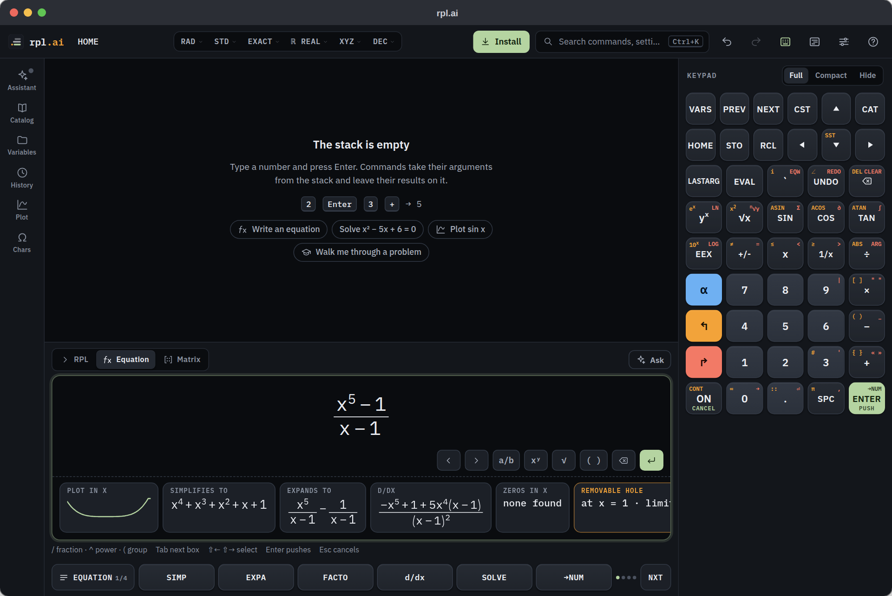

### Walk me through a problem

In Tutor mode the assistant plans a solution as a few steps, and the
calculator dry-runs every step before you see it. Each step explains the idea
and shows the keystrokes, with math, tables and code drawn as in the
assistant's replies. Press **Show me** to watch it happen, or
**I'll do it** to press the keys yourself; the tutor checks your stack and
says what's off. On a phone, I'll do it puts the assistant away so you can
type, and a note with the step's keys brings it back when you tap Check;
Show me puts it away too, so you see the step land on the stack. Hints come in stages. Start it from the Tutor switch in the
assistant, or Walk me through a problem in the Help menu. Choose Socratic or
Direct in Settings. Outside Tutor mode, when the assistant demonstrates
something on your stack, it pauses after each step worth a look, with a note
and a countdown, so you can follow along; Continue moves on sooner.

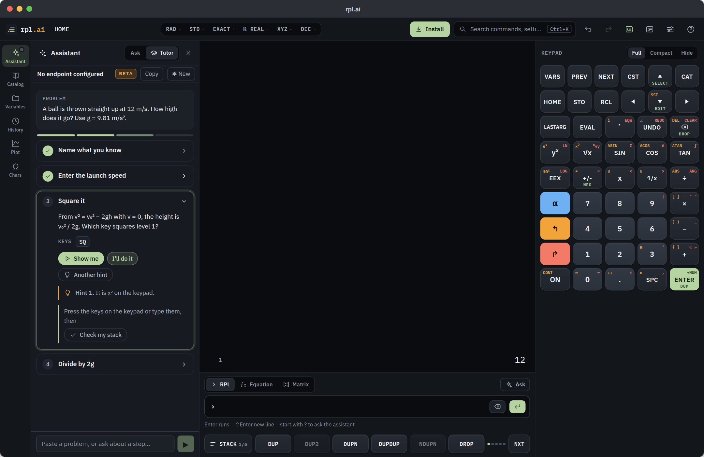

### Know what a key will do

Hover a soft key or a Catalog Run button, or hold a finger on a soft key,
and the stack shows the arguments it will take and the results it will
leave, computed on a copy of your stack. On a phone the held key still runs
as you lift your finger; slide it away to cancel. If it would fail, the culprit level is outlined and the reason shown.
Keys that need more arguments than the stack holds are dimmed. Previews
cover quick stack commands; algebra commands are not previewed.

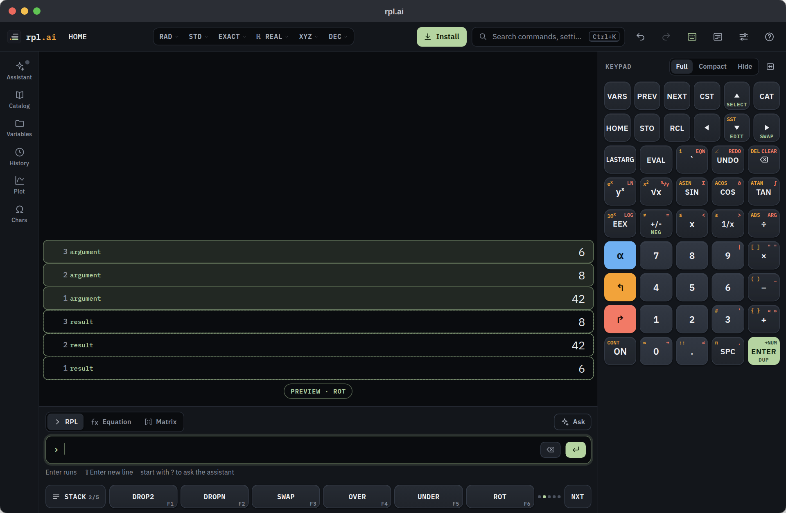

### Errors that help

Every error says what happened, why, and where. The culprit level is
outlined, the command's stack diagram is quoted, and fixes are one click
away: drop the bad value, swap levels, open the reference, or ask the
assistant to explain. A failed command gives its arguments back. As on the
HP, what ran before it in the line or program stays, the rest doesn't run and
the line is used up; Fix the line brings it back, and Undo restores the stack
from before it.

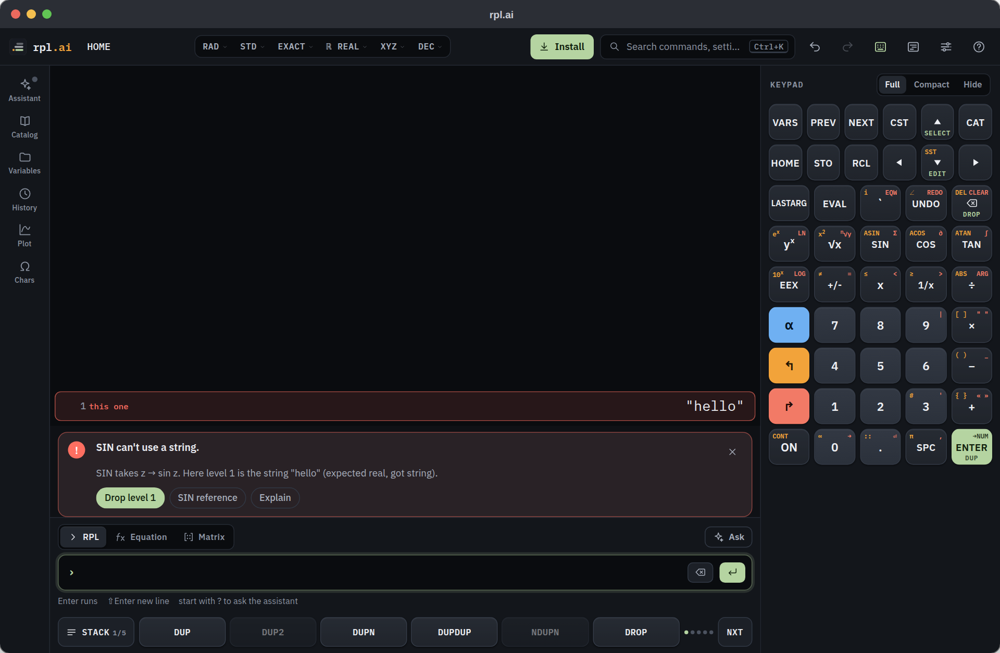

### Plots you can work with

`FUNCTION`, `POLAR`, `PARAMETRIC`, differential equations, scatter, bar and
histogram plots. Traces have checkboxes and editable expressions. Zoom, fit
and reset are on the canvas, the window is typed in directly, and Trace mode
(`T`) walks a cursor along the curves with live readouts. Expand to fill the
window, or go full screen. More canvas buttons copy the plot as an image,
download it as a PNG at the screen's pixel density, and, where the device
can share images, share it.

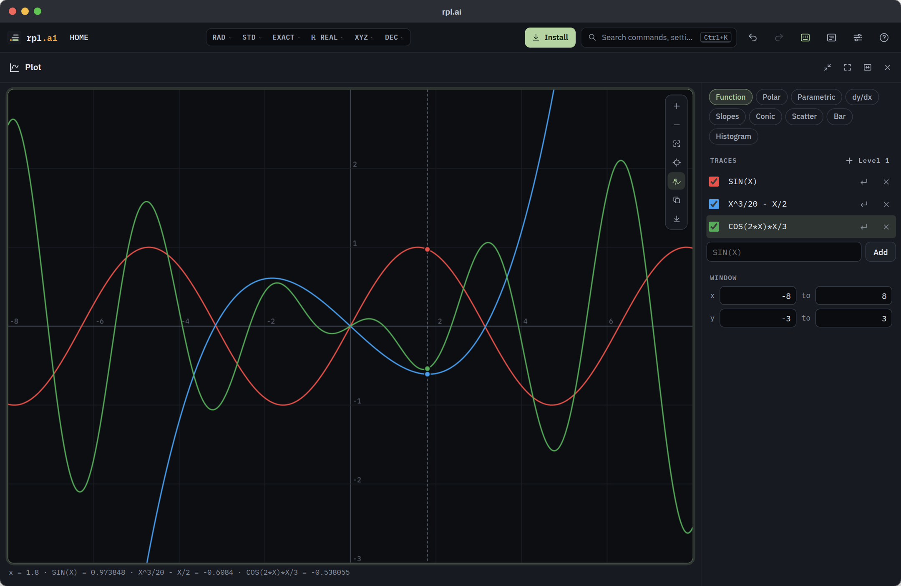

### Search everything

`⌘K` finds commands (by name, description or topic), settings, modes, menus,
variables and constants. For quick commands, the selected result shows what
it would leave on your stack, why it can't run, or the mode or variable it would change; `→` opens its reference page. With nothing
typed, the commands you last ran from search come first, so on a phone
without the keypad a command you use often is two taps away.

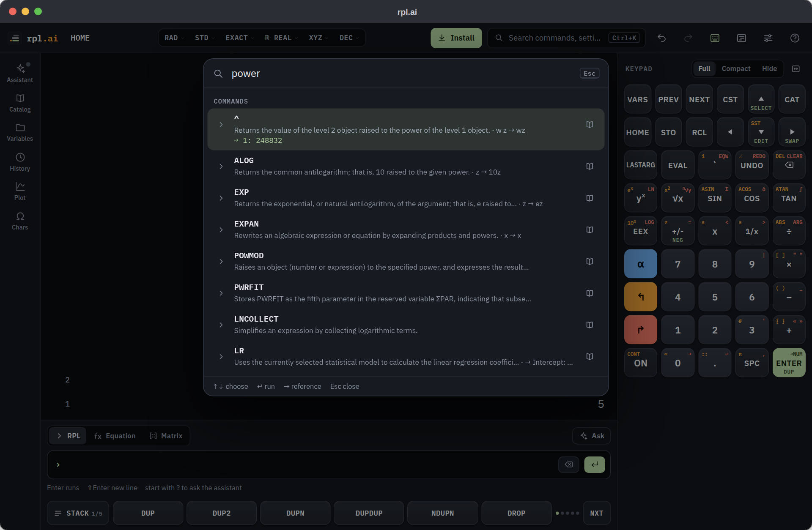

### Variables and directories

Browse, run, edit, rename and download variables. Drag them to reorder,
into folders or onto the breadcrumb; on a phone, drag a row by its grip, or
touch and hold it first, and the list scrolls when you near its edge. Back up the stack and the
whole HOME tree to a JSON file and restore it, archive to backup ports, and
import or export HP text files (`.rpl`).

Copy a matrix, vector or list (`⌘C` on a selected level) and paste it into
Excel, Google Sheets or Numbers: it arrives as cells. Copy a range of
numbers from a spreadsheet and paste it on the command line, where it
becomes a matrix (a vector for a single row, a one-column matrix for a
single column), or into the matrix writer's cells. Excel, Sheets and Calc
paste each number at the exact value the sheet holds, not as rounded as the
cell shows it. Currency, percentages, accounting negatives such as
`(300.00)` and the separators of other locales (`1.234,56`) are read as
numbers.

Spreadsheet files work too. Download a matrix, vector or list as `.csv`,
`.tsv` or Excel's `.xlsx` from its download button in the Variables drawer,
or with **Download as…** in a stack level's menu, which offers `.rpl` and
`.json` for any value. Upload a `.csv`, `.tsv`, `.xlsx`, `.rpl`, `.txt` or
`.json` file in the drawer, or drop one anywhere on the calculator to put it
on the stack. A table of numbers becomes a matrix (a vector for one row), a
text row above numbers is taken as a header and skipped, and a table with
other text becomes a list of rows. From a workbook rpl.ai reads the first
sheet's used range; dates arrive as Excel's serial numbers.

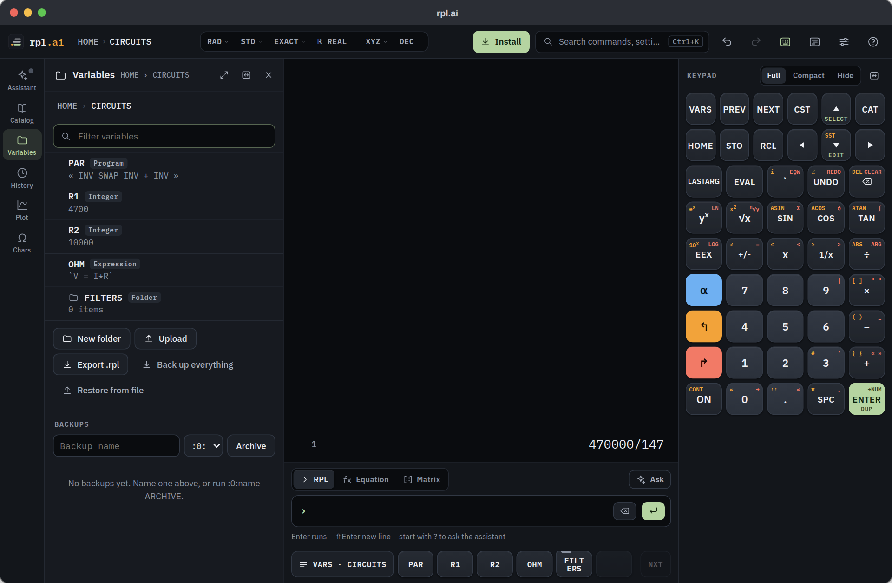

### Debugging

`HALT` suspends a program and shows it with the next instruction
highlighted. Continue, Step, Step into or Stop from the banner (or `CONT`,
`SST`, `SST↓`, `KILL`); Step runs a called program as one step, Step into
walks through it. `PROMPT` shows its message and waits for your input; on
a phone, while you type the answer, the banner shrinks to one row so the
stack stays in view. `MSGBOX` shows its message with an OK key and goes
on when you tap it or press Enter on an empty line. `INPUT` asks: its
prompt is the banner, the text it offers is on the command line, and
Enter or OK hands the line back to the program as a string (the HP's `V`
option asks that it parse first; its cursor position and α lock are
taken, ALG is not). `CHOOSE` lists its choices in a popover: a tap
answers with the choice (or the second object of a `{ display result }`
pair) and 1; the marked choice is highlighted, the arrow keys move it, a
typed letter moves it to the next choice that starts with the letter,
and Enter answers with it; Cancel gives 0. `DISP` writes a message on
one of seven display lines above the command line and `CLLCD` blanks
them; the text goes when the program ends or pauses unless `FREEZE`
keeps it until the next key. `WAIT` pauses a program for a number of
seconds, or with 0 (or -1, which brings the soft keys up in minimal
view) waits for a key and returns its HP key code: 92.1 for the 1 key,
on the keypad or typed, 11.1 for the first soft key, 105.1 for Enter or
the Enter chip on its banner. The display stays through a `WAIT`. `KEY`
looks for a key without waiting: 0, or the key's row and column and 1 (81
for ↰, 105 for Enter), so `DO UNTIL KEY END` waits for one; a program
polling it pauses every 50 ms for the page to take a key, its stack and
display updating as it runs. `BEEP` sounds a tone, hertz then seconds
(`440 .5 BEEP`); tones in a row play one after another, and flag -56,
which silences the error beep, silences them too. `INFORM` opens its form in a sheet: a field per label with its
help as the placeholder and its initial value typed in, OK parses each
field (an empty one gives `NOVAL`, the name NOVAL here), checks it
against the field's types and answers with the values and 1, Cancel with
0; Reset puts the reset values back. A program on the stack can be
stepped from the start with `DBUG`, or with Debug in its level's ⋯ menu.

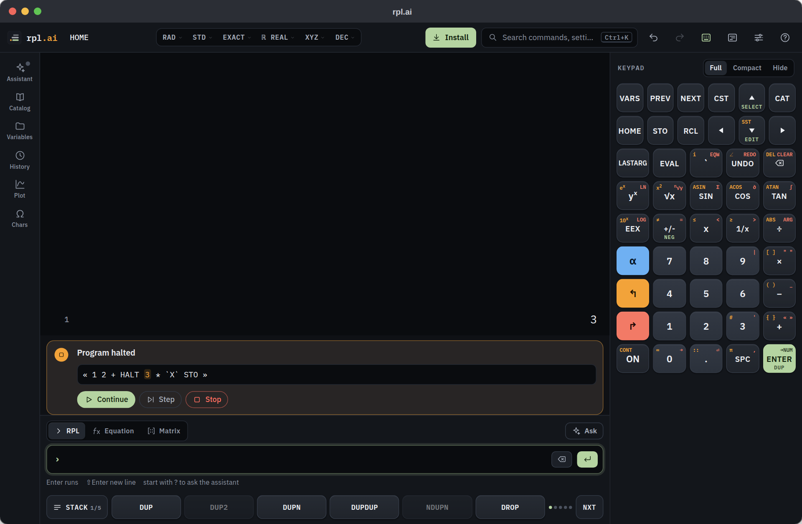

### Three looks, and a Minimal view

Graphite and Paper follow your system's dark or light setting; Classic LCD
reimagines the original display, whose annunciators you tap to change a
mode. In minimal view on a phone under 390 px wide it shows only the lit
ones, as the HP's own header does, so the menu and leave buttons stay in
reach. On a phone the status bar takes the colour of the look you pick. Minimal view strips everything back to the
status line, the stack and the command line (`⇧⌘F`); a setting keeps the
soft keys. On a phone it has a menu of its own (see [On a phone](#on-a-phone)).

On a wide screen the tools rail with its drawer and the keypad each dock on
the left or the right. Flip one with the dock button in its header, choose
Panels side and Keypad side in Settings, or search for "dock". The drawer
then resizes from its inner edge.

| Classic LCD | Paper |
|:---:|:---:|
| 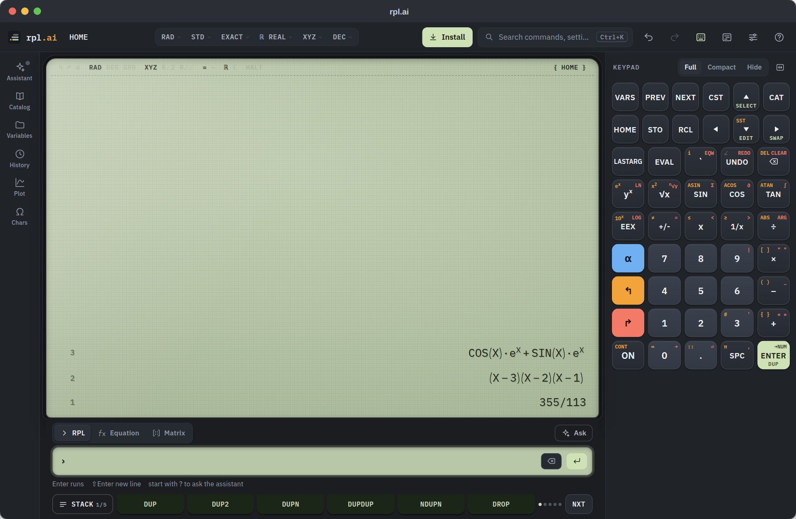 | 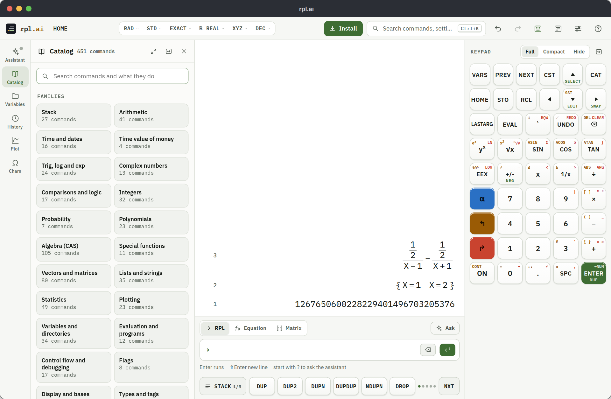 |

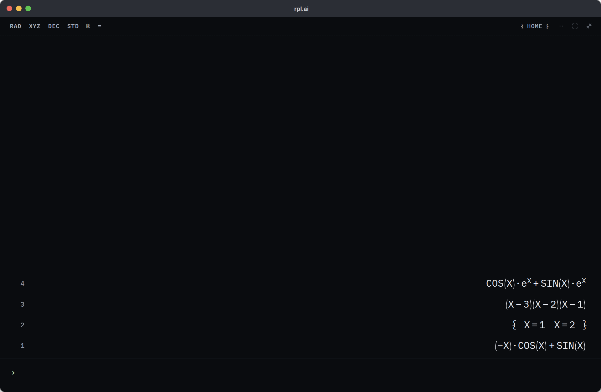

---

## Set up the assistant

The calculator needs none of this. The assistant is optional, and nothing
leaves your browser until you connect a model.

It works with [Ollama](https://ollama.com), a free app that runs AI models
on your own computer, and with other OpenAI-compatible servers. Each turn it
reads the live stack, modes and variables, looks commands up in the built-in
HP 50g reference, and dry-runs RPL on a scratch copy of the calculator
before acting for real. Every action is shown as a card, and each turn can
be undone in one click. Error banners and stack levels hand their context to
it with Explain or Ask.

Setup takes about ten minutes plus the model download. Ollama has to run on
a computer (Mac, Windows or Linux); phones and tablets connect to one.

### 1. Install Ollama

- **macOS** (Sonoma 14 or newer): download
  [Ollama.dmg](https://ollama.com/download/Ollama.dmg), drag Ollama to
  Applications and open it. When it first opens, let it install the
  command-line tool. A llama icon appears in the menu bar.
- **Windows** (10 22H2 or newer): run
  [OllamaSetup.exe](https://ollama.com/download/OllamaSetup.exe). No
  administrator rights are needed. Ollama then runs in the background, with
  an icon in the system tray. Open a *new* PowerShell or Terminal window
  afterwards so the `ollama` command is found.
- **Linux**: in a terminal, run
  ```sh
  curl -fsSL https://ollama.com/install.sh | sh
  ```
  It asks for your sudo password. If it says zstd is required, install it
  (`sudo apt-get install zstd`, `sudo dnf install zstd` or
  `sudo pacman -S zstd`) and run it again. On systems with systemd it
  installs and starts a service named `ollama`; without systemd, start
  Ollama yourself with `ollama serve`.

To check it, open <http://localhost:11434>. It should say
**Ollama is running**.

### 2. Get a model

The assistant works best with a model that supports **tools**, and larger
models follow RPL better. Pick one:

| Model | Where it runs | What you need |
|---|---|---|
| `qwen3.5` | your computer | about 14 GB of GPU memory or Mac unified memory |
| `gemma4` | your computer | about 12 GB |
| `gpt-oss:20b` | your computer | about 16 GB |
| `qwen3.5:cloud`, `gpt-oss:120b-cloud` | Ollama's servers | an ollama.com account; see [Cloud models](#cloud-models) |

Download a local one with, for example:

```sh
ollama pull qwen3.5
```

`ollama ls` lists your models, and `ollama show <model>` lists `tools`
under Capabilities when the model supports them. Avoid older models such as
`llama3.1`, `llama3.2` and `mistral`; Ollama itself flags them as poor at
this kind of tool use. On a computer without a capable GPU, local models
are slow; a cloud model is the better choice there.

### 3. Let rpl.ai talk to Ollama

Ollama answers only web pages it trusts. It trusts `localhost` out of the
box, so it needs to be told about the hosted app. Set `OLLAMA_ORIGINS` to
exactly `https://praevitium.github.io`: no `/rpl.ai`, no trailing slash.
(For more than one origin, separate them with commas and no spaces; a
malformed entry can stop Ollama from starting.) Then **quit Ollama
completely and start it again**. A running Ollama doesn't see the change.

- **macOS**: in Terminal, run
  ```sh
  launchctl setenv OLLAMA_ORIGINS "https://praevitium.github.io"
  ```
  Then click the menu-bar icon, choose **Quit Ollama**, and open Ollama
  again from Applications. This setting is lost when you restart or log
  out, and Ollama starts at login without it, so after a restart run the
  line again and quit and reopen Ollama.
- **Windows**: quit Ollama from the tray icon. Open Settings (Windows 11)
  or Control Panel (Windows 10), search for "environment variables", and
  choose **Edit environment variables for your account**. Click **New**,
  enter the name `OLLAMA_ORIGINS` and the value
  `https://praevitium.github.io`, and click OK. Start Ollama again from the
  Start menu.
- **Linux** (systemd service): run `sudo systemctl edit ollama`. In the
  editor, between the two `###` comment lines near the top, type
  ```ini
  [Service]
  Environment="OLLAMA_ORIGINS=https://praevitium.github.io"
  ```
  Save, exit, and run `sudo systemctl restart ollama`. If `OLLAMA_ORIGINS`
  is already set there, add the origin to that value instead.
- **Running `ollama serve` yourself** (macOS or Linux):
  `OLLAMA_ORIGINS=https://praevitium.github.io ollama serve`.

To confirm it worked, run this (on Windows, type `curl.exe`):

```sh
curl -i -H "Origin: https://praevitium.github.io" http://localhost:11434/api/version
```

A reply with `Access-Control-Allow-Origin: https://praevitium.github.io`
means it worked. `403 Forbidden` means Ollama wasn't restarted or the value
is mistyped.

Don't use `OLLAMA_ORIGINS=*`: it lets every website you visit use your
Ollama.

### 4. Connect

1. In rpl.ai, choose Help › Ask the assistant (`⌘I`) and click
   **Enable assistant**.
2. Click **+ Add endpoint**. The address is already
   `http://localhost:11434/v1`; your models appear in the list once Ollama
   answers.
3. Pick a model and click **Add & connect**.

The first time, your browser may ask whether the page may reach other apps
and services on this device (Chrome, Edge and Firefox word it slightly
differently). Choose **Allow**; the connection needs it. If you blocked it,
click the icon to the left of the address, allow **Apps on device** (or
**Local network access**) and reload.

**Safari, and every browser on iPhone and iPad, can't do this step.** They
block a secure page from calling `http://localhost`, with no prompt and no
setting to change it. Use Chrome, Edge or Firefox on the computer, or run
rpl.ai yourself (below).

The assistant asks for a 32K-token context by default. On a computer with
little memory, choose 8K or 16K under Context in the endpoint settings.
Thinking models reason before answering unless you turn that off there.
Ollama models that support tools get native tool calling; others write
their tool calls as text.

### Cloud models

Ollama can run very large models on its own servers, so your computer only
relays the requests. rpl.ai still talks to **your** Ollama, which needs the
steps above.

1. Create a free account at [ollama.com](https://ollama.com).
2. On the computer running Ollama, run `ollama signin` and approve the
   connection in the browser window it opens. (On a Mac or Windows PC, the
   Ollama app's Settings can sign you in too.)
3. Add a cloud model so it shows in rpl.ai's list. This fetches only a tiny
   placeholder:
   ```sh
   ollama pull qwen3.5:cloud
   ```
   Cloud model names end in `-cloud` or `:cloud`. Browse them at
   [ollama.com/search?c=cloud](https://ollama.com/search?c=cloud).
4. In rpl.ai, open the endpoint settings and pick the cloud model.

The free plan includes a small monthly allowance; more use needs credits or
a paid plan ([pricing](https://ollama.com/pricing)). Ollama says it doesn't
store cloud prompts or train on them. Local models never leave your
computer.

rpl.ai can't use Ollama's hosted API (`https://ollama.com/v1`) directly.
Browsers can't call it from a web page, and Ollama asks that API keys stay
out of browser code. The app says so if you try.

### Other setups

- **Run rpl.ai yourself.** With [Node.js](https://nodejs.org) installed,
  clone this repository, run `npm install` once and `npm run serve`, and
  open **http://localhost:5050**. From `localhost` every browser works,
  Safari included, and Ollama needs no `OLLAMA_ORIGINS`.
- **Ollama on another computer.** On that computer, turn on
  Settings › Expose Ollama to the network (Mac and Windows app), or add
  `Environment="OLLAMA_HOST=0.0.0.0:11434"` to the Linux service. Connect
  to `http://<its address>:11434`. A secure page can't call a plain-HTTP
  address on your network, so either open rpl.ai over plain HTTP from a
  server you run (and add that page's origin to `OLLAMA_ORIGINS`), or put
  Ollama behind HTTPS. Anyone on your network can use an exposed Ollama.
- **Other OpenAI-compatible servers** work if they accept requests from a
  web page. Put an API key in the endpoint settings if the server needs
  one.

### If it doesn't connect

The endpoint form explains the failure it sees:

| It says | Do this |
|---|---|
| Waiting for your browser | Find the browser's prompt about apps and services on this device, near the address bar, and choose **Allow**. Until you answer it, nothing reaches Ollama |
| Your browser is blocking this page | You chose Block earlier: click the icon to the left of the address, allow **Apps on device** (**Local network access** in older Chrome, **Device apps and services** in Firefox) and try again |
| answered but refused this page's origin | Set `OLLAMA_ORIGINS` (step 3), then quit and restart Ollama |
| Nothing answered | Check that Ollama is running (<http://localhost:11434>) |
| Safari … blocks HTTPS pages | Use Chrome, Edge or Firefox, or run rpl.ai yourself |
| served over HTTPS … blocks plain-HTTP requests | See "Ollama on another computer" above |
| `unauthorized` from a cloud model | Run `ollama signin` on the computer running Ollama |

---

## Limitations

rpl.ai aims to keep everything that makes the HP 50g good, without its
bugs, and to go beyond it where a modern screen helps. It isn't finished,
and these are the gaps worth knowing about.

**Commands.** The HP 50g manual lists 825 commands; rpl.ai has 636. The
Catalog and the command reference mark what is available. Not there yet:

- setting the clock: `→DATE`, `→TIME` and `CLKADJ`. The clock is the
  device's own; `DATE`, `TIME`, `TICKS` and `TSTR` read it, and `DATE+`
  and `DDAYS` count days, with flags -41 and -42 for the formats, which
  the TIME menu's 24H and D.M.Y keys set. Its ALRM folder keeps
  appointment alarms: `{ 10.192026 9.3 "Dentist" } STOALARM` stores one
  and gives its index, and `RCLALARM`, `DELALARM`, `FINDALARM`, `ACK` and
  `ACKALL` work on the list, which is saved with the stack. An alarm that
  comes due while the app is open shows its message in a note with an ACK
  button, a buzz and a tone (set flag -57 for quiet); one missed while the
  app was closed shows as past due the next time it opens. While one is
  past due, the HP's alert annunciator ((•)) lights in the status line,
  and a tap on it brings the note back.
- PICT and the drawing commands (PVIEW, ERASE, LINE, BOX, LABEL and the
  rest). The plot-window commands (XRNG, YRNG, CENTR, SCALE and the rest) set
  PPAR, and plots start in its window, but INDEP, DEPND, RES and AXES are only
  stored so far
- the HP's numbered menus for MENU and TMENU (a list, a name holding one
  or 0 work), and DEF
- parts of the CAS, such as DESOLVE and LDEC (SOLVE, SOLVEVX, ISOL,
  LINSOLVE, SYST2MAT, ROOT, ZEROS, TAYLR, TAYLOR0 and SERIES are here).
  Symbolic commands such as EXPAND and SOLVE refuse an algebraic with units
  in it, which EVAL and →NUM work out.

**Left out on purpose.** USER mode and key assignments, ENTRY mode, the
NUM.SLV solver screens, FINANCE, TIME, OFF, libraries (LIB, ATTACH and
port management other than ARCHIVE and RESTORE), Saturn assembly and
System RPL, and IR and serial transfer.

**Behaviour that differs from the HP 50g.**

- `BEEP` doesn't hold the program while its tone plays; tones in a row still
  sound one after another.
- Alarms carry a message only: `STOALARM` refuses an object to run (the
  HP's control alarms), and an alarm comes due only while the app is open.
  A key press doesn't acknowledge an alarm; its note's ACK button does.
- BESTFIT pushes the model it picked and its correlation, as LINFIT does,
  as well as making it the current one.
- Plot commands open the plot view instead of drawing into PICT.
- MOLWT answers in g/mol, from standard atomic weights, where the HP
  writes g/gmol, so its last digits can differ from the HP's.
- There is no ON key to break a running program. A command or program that
  runs longer than 10 seconds is stopped, the stack is put back, and the
  error says why. A loop stops after 1,000,000 passes.
- `RCLF` returns the numbers of the set flags as a list, and `STOF` takes
  that list back, instead of the HP's binary-integer flag words.
- A local variable is visible to programs called from its body; on the HP
  only `←` names are.
- Inside an algebraic a unit runs to the next operator, so a compound unit
  goes in parentheses: `'9.81_(m/s^2)*T'`. `'5_m/s'` is 5 m divided by a
  variable `s`.
- `ZEROS` always returns a list, even of one root.
- ⌫ on an empty line leaves the stack alone, where the HP's drops level 1.
  DROP is on the STACK menu, the key strip above a phone's keyboard and a
  level's menu, and ⌫ still removes a selected level.
- A line that starts with `?` asks the assistant, so the undefined symbol `?`
  comes from the Catalog, command search, `'?'` or anywhere later in a line.

**The algebra engine.** Giac is not the HP 49/50's CAS, so answers can come
back in a different but equivalent form. It is an 11.8 MB download, fetched
once. One CAS command, such as factoring a huge polynomial, can't be
interrupted: the page stops responding until it finishes. The equation
writer's insights and the previews never wait on it.

**Your data.** The stack and variables live in this browser's storage on
this device. They don't sync, and clearing the site's data, or closing a
private window, erases them. If the browser blocks site data altogether,
rpl.ai still runs but warns that nothing is being saved. Back them up with
Back up everything in the Variables drawer. Spreadsheets exchange CSV, TSV
and `.xlsx` files and copied cells; of a workbook only the first sheet is
read, and formulas arrive as their last calculated values.

**The assistant.** It is only as good as the model you connect, and small
models make mistakes in RPL; check its work, and use Undo freely. It needs
Ollama or a compatible server, it can't use ollama.com's API directly, and
Safari and iPhone or iPad browsers can't reach a local Ollama from the
hosted app.

**Browsers.** Firefox runs rpl.ai but can't install it as an app. The first
visit needs a network connection; after that it works offline.

---

## For developers

```bash
npm install      # one-time setup
npm run serve    # http://localhost:5050
```

The app is the static files in `www/`: plain ES modules with no bundler.
`www/precache.js` and `www/src/build-info.js` are generated by
`npm run build-info`, which `npm install`, `npm run serve` and the Pages
deploy run for you; they are not checked in. Any static web server can
host `www/` after that. Browsers won't run it from `file://`, because ES
modules and the Giac WebAssembly need http(s), and they install it and keep
it offline only over https or on localhost. Every push to `main` publishes
`www/` to GitHub Pages.

### Project layout

```
www/                  The app: static files served as-is
  index.html          Shell and icon sprite
  sw.js               Offline cache (the precache list is generated)
  src/app.js          Wires the UI together
  src/rpl/            Stack engine, parser, evaluator, formatter, persistence
  src/rpl/ops/        Command families; src/rpl/ops.js re-exports the registry
  src/rpl/cas/        Giac adapter and AST↔Giac conversion
  src/ui/             Stack display, input and writers, menus, keypad, drawers, plots, search
  src/ai/             Assistant: chat, tools, tutor, endpoint client
  css/                Design tokens, themes and components
  docs/               HP 50g command reference behind the Catalog and help
  fonts/              IBM Plex subsets
  icons/, manifest.webmanifest   App icons and install manifest
  hp50-all.json       Example variables loaded on first launch
  vendor/             Giac, decimal.js, fraction.js, complex.js, CodeMirror, KaTeX, Mermaid
tests/                Node test suites, one area per file
scripts/              Build info, offline precache, README screenshots, command-reference upkeep
screenshots/          Images used above
utils/                Pre-commit hook: sanity smoke, optional full and persist suites
.github/workflows/    Publishes www/ to GitHub Pages on every push to main
```

Shipped commands are the `register` calls under `www/src/rpl/ops/`.

### Testing

The tests are plain Node ES modules with no framework:

```bash
npm test                                  # every area except persistence
node tests/test-persist.mjs               # save, load, export and backups
node tests/test-equation-editor.mjs       # one area
node tests/flake-scan.mjs                 # rerun the suite to catch flaky results
node tests/flake-bisect.mjs --label "…"   # find the file order that breaks an assertion
```

In Node the CAS answers come from Giac fixtures each test registers; the
real Giac WebAssembly runs only in the browser.

`npm run screenshots` regenerates the images in this README. It drives a
local Chrome through Playwright (`CHROME_PATH` points it at another
browser). Name scenes to redo only those: `npm run screenshots -- hero
phone`. `RPLAI_SCREENSHOT_LLM` and `RPLAI_SCREENSHOT_MODEL` add the
assistant scene.

What changed is in [RELEASE_NOTES.md](RELEASE_NOTES.md).

---

## Why this exists

I've always loved the HP 48/49/50 interface. RPL's stack makes a calculation
read the way you'd work it by hand: operands first, then the operation. User
programs are first-class: store one under a name and it behaves exactly like
a built-in. The hardware aged. Emulators kept the 131×80 screen, and the HP
Prime left too much of the language behind. I wanted RPL with a big screen,
a real keyboard, deep undo and a proper file manager. When AI-assisted
development made a project of this scope practical, rpl.ai is what came out
of it.

## Acknowledgements

rpl.ai bundles or depends on:

- **[Giac](https://www-fourier.univ-grenoble-alpes.fr/~parisse/giac.html)**
  (GPL-3.0+): Bernard Parisse's computer algebra system, as WebAssembly via
  [emgiac](https://github.com/adriweb/emgiac), with GMP, MPFR and MPFI (LGPL)
- **[decimal.js](https://github.com/MikeMcl/decimal.js)**,
  **[fraction.js](https://github.com/rawify/Fraction.js)** and
  **[complex.js](https://github.com/rawify/Complex.js)** (MIT): decimal,
  rational and complex arithmetic
- **[CodeMirror 6](https://codemirror.net/)** (MIT): the command line
- **[KaTeX](https://katex.org/)** (MIT): math in the assistant's replies,
  and the ∠ glyph
- **[Mermaid](https://mermaid.js.org/)** (MIT): diagrams in the assistant's
  replies
- **[IBM Plex](https://www.ibm.com/plex/)** (OFL): the typefaces

See [NOTICE](NOTICE) for full attribution.

## License

rpl.ai is licensed under the **GNU General Public License v3.0 or later**
(`SPDX-License-Identifier: GPL-3.0-or-later`); see [LICENSE](LICENSE).
Because Giac is GPL-3.0+, the combined work must be distributed under
GPL-3.0-or-later, and can't be relicensed more permissively while Giac is
bundled.

*HP, HP 48, HP 49, HP 50g and HP Prime are trademarks of HP Inc. rpl.ai is
an independent reimplementation, not affiliated with or endorsed by HP.*
